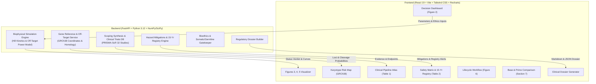

# CRISPR-Cas9 Clinical Decision Support & Simulation Platform

> **Translational Software Implementation of the Research Publication:**  
> *"CRISPR-Cas9 in Human Health: Where the Science Actually Stands — Therapeutic Progress, Safety Trade-offs, and the Ethics That Come With Them"*  
> **Authors:** Badru MD, Ghansah V, Adesanya IO, David J, Okechukwu NC, Eke DO (September 2026)  
> **Citation:** *Aust J Biomed Res. 2026;2(3):aubm024*

---

## 🔬 System Overview

This full-stack clinical platform directly implements the **Decision-Support Workflow (Figure 2)**, **Predictive Simulation Engines (Figures 3, 4, and 5)**, **Therapeutic Lifecycle & Feedback Systems (Figure 6)**, and comprehensive evidence databases (**Table 1** and **Table 2**) described in the research paper.

The software empowers clinical researchers, bioinformaticians, and regulatory reviewers to simulate therapeutic CRISPR-Cas9 protocols, inspect chromosome-wide genomic hazards across the human karyotype (GRCh38), evaluate bioethical compliance (strictly gating somatic vs germline interventions), and benchmark against landmark clinical trial programs (such as Exa-cel, NTLA-2001, NTLA-2002, CTX310, and EDIT-101).

---

## 🏗️ Architecture & Technology Stack

## 📋 Direct Mapping to Research Paper Content

| Paper Section / Figure | Platform Module / Component | File Location |
| :--- | :--- | :--- |
| **Figure 1 (PRISMA-ScR Architecture)** | PRISMA Scoping Modal & Methodology Flowchart | [`frontend/src/components/PrismaScopingModal.tsx`](file:///frontend/src/components/PrismaScopingModal.tsx) |
| **Figure 2 (Decision Workflow)** | Core Decision Support Dashboard & Status Verdict | [`frontend/src/components/SimulationEngineView.tsx`](file:///frontend/src/components/SimulationEngineView.tsx) |
| **Figure 3 (Efficacy vs Delivery)** | Figure 3 Delivery Efficiency Curve (3 Cas9 Doses) | [`backend/app/services/simulation_engine.py`](file:///backend/app/services/simulation_engine.py) |
| **Figure 4 (Tradeoff Plot)** | Figure 4 Scatter Plot Colored by Status Verdict | [`frontend/src/components/SimulationEngineView.tsx`](file:///frontend/src/components/SimulationEngineView.tsx) |
| **Figure 5 (Concentration Curve)** | Figure 5 Concentration-Response Kinetic Curve | [`backend/app/services/simulation_engine.py`](file:///backend/app/services/simulation_engine.py) |
| **Figure 6 (Lifecycle & Feedback)** | Therapeutic Lifecycle & Manufacturing Pipeline | [`frontend/src/components/LifecycleWorkflow.tsx`](file:///frontend/src/components/LifecycleWorkflow.tsx) |
| **Table 1 (Clinical Pipeline)** | Clinical Trials Atlas & PRISMA ScR Studies | [`frontend/src/components/ClinicalTrialsExplorer.tsx`](file:///frontend/src/components/ClinicalTrialsExplorer.tsx) |
| **Table 2 (Safety & Mitigations)** | Safety Hazard Matrix & 15-Year Registry | [`frontend/src/components/SafetyMatrixView.tsx`](file:///frontend/src/components/SafetyMatrixView.tsx) |
| **Section 5 & 8 (Bioethics & Policy)** | Ethics Demarcation, Consent, & Equity Gatekeeper | [`frontend/src/components/EthicsGovernanceView.tsx`](file:///frontend/src/components/EthicsGovernanceView.tsx) |
| **Section 7 (Emerging Technologies)** | Conventional CRISPR vs Base vs Prime Editing | [`frontend/src/components/EmergingTechComparison.tsx`](file:///frontend/src/components/EmergingTechComparison.tsx) |

---

## 🛡️ License & Academic Citation
Based on research published in the *Australian Journal of Biomedical Research* (September 2026).
